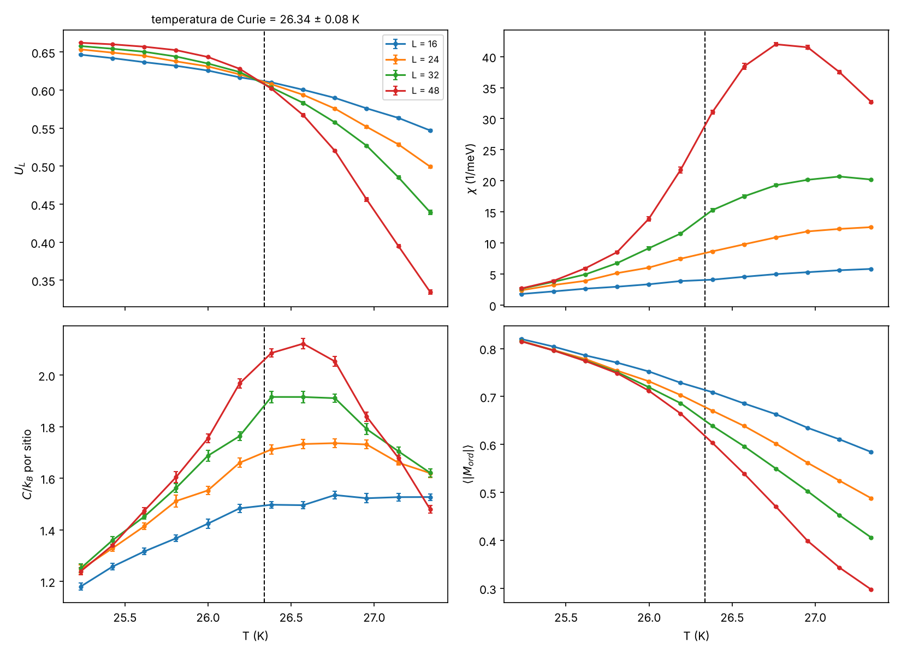
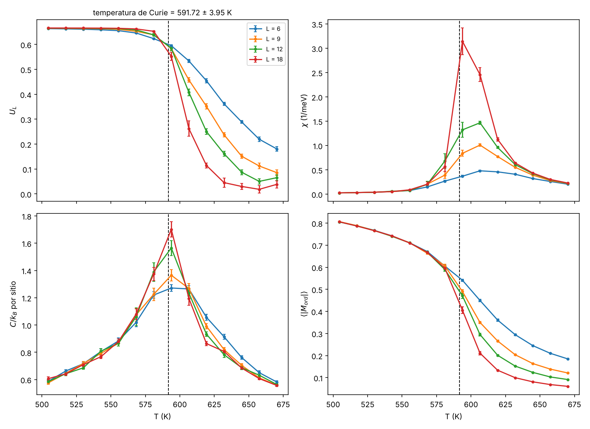

# Resultados

## 1. Validación contra la solución exacta de Onsager

Red cuadrada, un átomo por celda, |J| = 1 meV a primeros vecinos, L = 16, 24,
32 y 48, algoritmo híbrido, 30 000 medidas por temperatura.
Valor exacto: k_B T_c / |J| = 2 / ln(1 + √2) → **T_c = 26.333 K**; U* ≈ 0.6107.

| Caso | T_c, ajuste en 1/L | T_c, ajuste en L⁻³ | U* | Error (1/L) |
|---|---|---|---|---|
| FM (Curie) | 26.337 ± 0.084 K | 26.312 ± 0.037 K | 0.612 | 0.02 % |
| AFM (Néel) | 26.235 ± 0.090 K | 26.284 ± 0.037 K | 0.615 | 0.37 % |

Criterio de aprobación: error < 0.5 %. **Aprobado** en los dos casos y en dos
corridas independientes (la primera, antes de cambiar la calibración de Wolff,
dio 0.37 % y 0.27 %). En las dos corridas el ajuste en L⁻³ (1/ν + ω, el
corrimiento teórico de los cruces del cumulante) quedó tan cerca o más cerca
del exacto que el ajuste en 1/L. Datos: `docs/validacion_onsager.json`.

## 2. MXene Nb–Ti 30 % desnuda (modelo de Ising)

**Entrada.** J de TB2J del informe "MXene Nb–Ti 30 %: magnetismo de la
monocapa mixta y la desnuda" (13 oct 2026). El informe no incluye la lista
completa de enlaces ni las posiciones, así que `materiales/nbti30_desnuda.py`
reconstruye la red de 10 Ti con supuestos documentados. Controles contra el
informe: número de enlaces por capa y distancia, J₀ por capa (31 y 51.9 meV) y
λ_max de J(q = 0) = 49.19 meV (informe: 49.2 meV, no usado en el ajuste).
Conversión: `factor_J = 2` (TB2J suma sobre i ≠ j).

**Estado fundamental** (encontrado por el código): ferromagnético, no
degenerado → temperatura de Curie, como en el informe.

**Simulación.** L = 6, 9, 12, 18 (supercelda L × 2L, de 7.5 a 22.5 nm),
algoritmo híbrido, 10 000 medidas por temperatura.

| | T_c |
|---|---|
| Este código, Ising | **592 ± 4 (estad.) ± 1 (sist.) K** |
| Vampire, Heisenberg + anisotropía (informe) | 170–213 K |

**Lectura.** La diferencia es la esperada y no indica un error. El modelo de
Ising supone que los espines solo pueden apuntar ±1 a lo largo de un eje fácil,
lo que es cuantitativo cuando MAE ≳ 10 k_B T_c. En la desnuda la MAE es de
1 a 10 meV/Ti y k_B T_c ≈ 15–18 meV, es decir MAE / (k_B T_c) ≈ 0.02–0.2. Con
anisotropía tan débil los espines se inclinan y el orden se pierde a una
temperatura mucho menor; el Ising solo da una **cota superior**. Para T_c
cuantitativa de este material corresponde el modelo de Heisenberg con
anisotropía.

**Pendiente.** (i) Reemplazar la reconstrucción por el `exchange.out` real de
TB2J. (ii) τ_int llegó a ~54 medidas en L = 18 cerca de T_c: para producción,
N_meas ≥ 50 000.

